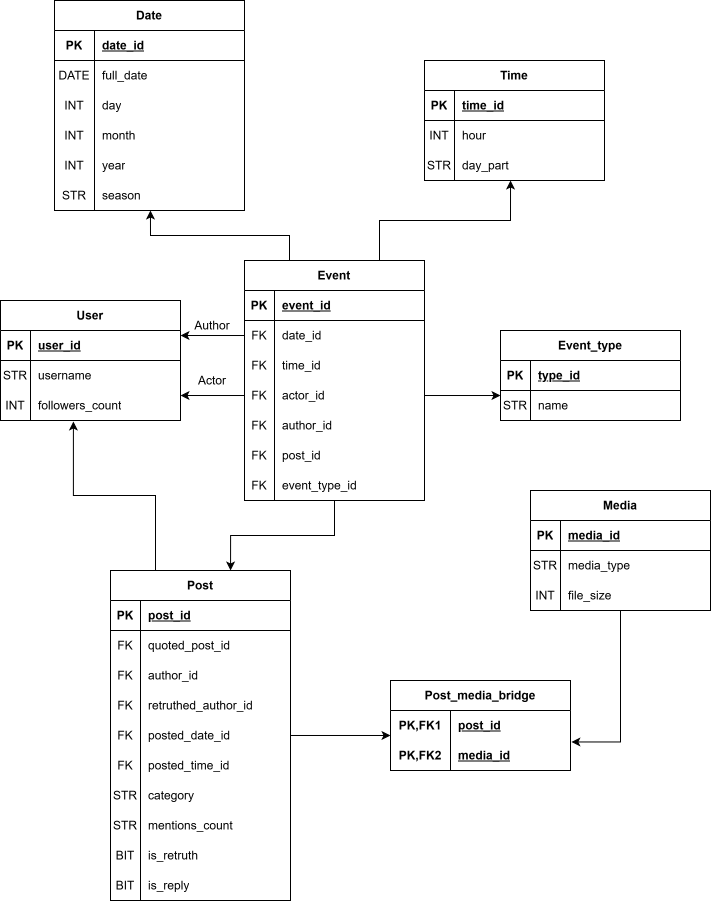

## 1. Analisi preliminare
| ID | Dimensions | Measures | Metrics |
| :--- | :--- | :--- | :--- |
| **(8)** | User (`username`), Time (`hour`, `day_part`), Event_type (`name`) | — | No of posts (night/day), No of likes (night/day), Night-day post score, Night-day like score |
| **(9)** | Post (`category`, `is_retruth`), Date (`month`, `year`), Event_type (`name`) | — | Cumulative likes, Total posts (incl. reposts), Cumulative likes-to-posts ratio |
| **(10)** | Post (`post_id`, `category`), Event_type (`name`) | — | No of likes, No of posts, Average likes per category, Avg likes ratio (category vs other categories) |
| **(11)** | User (`username`), Post (`post_id`, `category`, `is_retruth`, `retruthed_author_id`), Event_type (`name`) | — | No of likes per post, No of posts, Trending percentage, Trending factor |
| **(12)** | User (`username`, `followers_count`), Post (`post_id`, `is_retruth`, `is_reply`, `mentions_count`, `category`), Date (`full_date`, `day`, `month`, `year`), Event_type (`name`) | — | No of likes, Max likes (most liked original post) |
| **(13)** | Post (`post_id`, `quoted_post_id`), Event_type (`name`) | — | No of likes (quoting post), No of likes (quoted post), Difference in likes |
| **(15)** | Date (`month`, `year`), User (`username` as Actor) | — | Total events (by account and overall total) |
| **(16)** | Date (`year`), Post (`post_id`), Media (`media_id`, `media_type`, `file_size`), Event_type (`name`) | — | Yearly media storage space, Average yearly media storage space, Grand total media storage space |
| **(17)** | Post (`category`), Date (`year`) | — | No of events, YoY percentage change in events |
| **(18)** | Date (`season`, `year`), Post (`category`), Event_type (`name`) | — | No of likes, Previous year seasonal avg likes, Seasonal likes percentage increase |
| **(19)** | User (`username`, `followers_count`), Post (`post_id`, `category`, `is_retruth`, `is_reply`), Event_type (`name`) | — | No of likes per post, No of posts per category |
| **(20)** | Date (`full_date`, `day`, `month`, `year`), Post (`post_id`, `category`), Event_type (`name`) | — | No of posts, No of likes |
| **(21)** | User (`username`), Date (`month`, `year`), Time (`day_part`), Post (`post_id`, `category`, `is_retruth`), Event_type (`name`) | — | No of posts, Share of ReTruths, Share of night posts, Likes per post, Share of each post category |

---

### Granularità del fatto

| Description | Preliminary Dimensions | Preliminary Measures |
| :--- | :--- | :--- |
| A fact *Event* is a single user action occurring on Truth Social (`truth` creation, `retruth`, `like`, or `reply`) at a specific date and time, performed by an actor user on a post (published by an author user, optionally reposting or quoting another post, and optionally associated with media files). | Date, Time, User (Actor & Author), Post, QuotedPost, Event_type, Media | — *(factless event count; `file_size` is modeled as a descriptive attribute of `Media`)* |

---

## 2. DW Schema

### Caratteristiche architetturali principali
* **Modello Star/Snowflake ibrido:** la tabella dei fatti centrale `Event` è collegata direttamente alle dimensioni principali (`Date`, `Time`, `User`, `Post`, `Event_type`), mentre `Post` presenta gerarchie condivise (*shared hierarchies*) verso `User`, `Date` e `Time`, oltre a una tabella ponte (`Post_media_bridge`) per gestire la relazione molti-a-molti ($M:N$) con `Media`.
* **Dimensioni Role-Playing:** `User` partecipa con più ruoli (`actor_id` per chi esegue l'azione in `Event`, `author_id` per l'autore del post sia in `Event` sia in `Post`, e `retruthed_author_id` in `Post` per l'autore originario di un repost). Analogamente, `Post` punta ricorsivamente a sé stessa tramite `quoted_post_id`.
* **Copertura temporale asimmetrica (Assignment 6 e 7):** poiché la fact table `Event` contiene solo gli eventi del periodo **2022–2024** mentre le dimensioni (`Post`, `User`) contengono record raccolti fino al **2026**, il calendario `Date` è esteso fino al 2026 e `Post` mantiene al suo interno `author_id`, `posted_date_id` e `posted_time_id` per preservare le informazioni dei post privi di eventi registrati.

---

## 3. Dimesioni e attributi dimensionali

### 3.1 Dimensione `Date`
Rappresenta la dimensione temporale a granularità giornaliera, derivata dai timestamp degli eventi e dei post.

| Attributo | Tipo / Chiave | Descrizione e Origine | Utilizzo negli Assignment |
| :--- | :--- | :--- | :--- |
| **`date_id`** | `INT` (**PK**) | Chiave surrogata/parlante in formato `YYYYMMDD` (es. `20220808`). Collega `Event.date_id` e `Post.posted_date_id`. | **Ass. 3, 4, 5, 7:** chiave di join tra `Event`/`Post` e `Date` durante ETL e caricamento su SQL Server. |
| **`full_date`** | `DATE` | Data completa in formato standard (`YYYY-MM-DD`). Rappresenta il livello foglia della gerarchia temporale. | **Ass. 12:** restituisce il giorno esatto di pubblicazione del post più apprezzato. **Ass. 14:** livello foglia della gerarchia temporale nel cubo OLAP. **Ass. 20:** filtra l'intervallo continuo `2022-08-01` – `2022-08-15` e raggruppa per giorno intorno all'8 agosto 2022. |
| **`day`** | `INT` | Giorno del mese (`1..31`). | **Ass. 12 e 20:** supporto al raggruppamento e alla visualizzazione giornaliera (es. asse X del grafico dell'evento Mar-a-Lago). |
| **`month`** | `INT` | Mese dell'anno (`1..12`). | **Ass. 9:** raggruppamento mensile per il rapporto tra like cumulativi e post totali per categoria. **Ass. 15:** raggruppamento mensile in MDX per il totale eventi per account. **Ass. 21:** raggruppamento mensile (insieme a `year`) per analizzare l'attività di Donald Trump tra il 2022 e il 2024. |
| **`year`** | `INT` | Anno solare (es. `2022..2026`). | **Ass. 9, 15, 21:** disambigua i mesi su anni diversi (es. agosto 2022 vs agosto 2023). **Ass. 16:** aggrega lo spazio di archiviazione media per singolo anno e calcola la media annua. **Ass. 17:** confronta gli eventi di ciascuna categoria con l'anno precedente (`year - 1`). **Ass. 18:** confronta i like stagionali con la stessa stagione dell'anno precedente (`year - 1`). |
| **`season`** | `STR` | Stagione astronomica o meteorologica (`'Winter'`, `'Spring'`, `'Summer'`, `'Autumn'`), derivata da `full_date` in fase di preprocessing. | **Ass. 18:** raggruppa i like per stagione e filtra le categorie che superano la media della stessa stagione dell'anno precedente. |

---

### 3.2 Dimensione `Time`
Rappresenta la dimensione oraria intragiornaliera (24 righe, una per ciascuna ora del giorno).

| Attributo | Tipo / Chiave | Descrizione e Origine | Utilizzo negli Assignment |
| :--- | :--- | :--- | :--- |
| **`time_id`** | `INT` (**PK**) | Identificativo dell'ora (`0..23`). Collega `Event.time_id` e `Post.posted_time_id`. | **Ass. 3, 4, 5, 7:** chiave di join con la fact table `Event` e con `Post`. |
| **`hour`** | `INT` | Ora del giorno (`0..23`), estratta dal timestamp dell'evento o del post. | **Ass. 8:** permette di verificare o definire la soglia oraria notte/giorno (`20..23` e `0..7` vs `8..19`). **Ass. 14:** livello foglia della gerarchia oraria nel cubo OLAP. |
| **`day_part`** | `STR` | Fascia della giornata con due valori: `'Night'` (dalle 20:00 alle 07:59) e `'Day'` (dalle 08:00 alle 19:59). | **Ass. 8:** raggruppa direttamente post e like per calcolare il *night-day score* (`Night / Day`) di ogni utente. **Ass. 21:** calcola la quota mensile di post rilasciati di notte (`day_part = 'Night'`) da Donald Trump. |

---

### 3.3 Dimensione `User`
Contiene l'anagrafica degli account Truth Social estratta da `users.xml` (integrata con eventuali autori presenti solo nei post/eventi).

| Attributo | Tipo / Chiave | Descrizione e Origine | Utilizzo negli Assignment |
| :--- | :--- | :--- | :--- |
| **`user_id`** | `INT` / `BIGINT` (**PK**) | Identificativo univoco dell'account. Referenziato da `Event.actor_id`, `Event.author_id`, `Post.author_id` e `Post.retruthed_author_id`. | **Ass. 3–7:** chiave primaria per tutte le join role-playing sugli utenti. |
| **`username`** | `STR` | Handle/nome pubblico dell'account su Truth Social. | **Ass. 8 e 11:** identifica ciascun utente nei risultati delle statistiche (night-day score, trending percentage/factor) e filtra i repost di Donald Trump (`username = 'realDonaldTrump'`) tramite `retruthed_author_id`. **Ass. 12 e 19:** identifica gli account del top 10% follower e restituisce il nome account nel confronto tra categoria più popolare e più usata. **Ass. 15:** mostra il totale eventi mensili per ogni account. **Ass. 21:** filtra esclusivamente l'account di Donald Trump. |
| **`followers_count`** | `INT` | Numero di follower dell'account (da `users.xml`). Attributo descrittivo non aggregabile. | **Ass. 12:** ordina e filtra gli account che rientrano nel **top 10%** per numero di follower. **Ass. 19:** riutilizza lo stesso sottoinsieme di account top 10% identificato nell'Assignment 12. |

---

### 3.4 Dimensione `Event_type`
Mini-dimensione categorica (4 righe) che qualifica la natura dell'azione registrata nella fact table `Event`.

| Attributo | Tipo / Chiave | Descrizione e Origine | Utilizzo negli Assignment |
| :--- | :--- | :--- | :--- |
| **`type_id`** | `INT` (**PK**) | Chiave primaria numerica (`1..4`). Referenziata da `Event.event_type_id`. | **Ass. 3–7:** chiave di join con `Event`. |
| **`name`** | `STR` | Nome della tipologia di evento: `'truth'`, `'retruth'`, `'like'`, `'reply'`. | **Ass. 8, 9, 10, 11, 12, 13, 18, 19, 20, 21:** filtra gli eventi con `name = 'like'` per contare i mi piace ricevuti da ciascun post. **Ass. 8, 9, 10, 11, 20, 21:** filtra `name IN ('truth', 'retruth')` per contare i post pubblicati nel periodo 2022–2024. **Ass. 15 e 17:** non viene filtrato (si considerano tutti e 4 i tipi) per ottenere il conteggio totale degli eventi. |

---

### 3.5 Dimensione `Post`
Raccoglie tutti i metadati dei post (Truth) estratti da `truth.csv`, `quotes.json` e dal dataset `.arff` (Assignment 1), arricchiti dalla categorizzazione dell'Assignment 2.

| Attributo | Tipo / Chiave | Descrizione e Origine | Utilizzo negli Assignment |
| :--- | :--- | :--- | :--- |
| **`post_id`** | `STR` / `BIGINT` (**PK**) | Identificativo univoco del post. Referenziato da `Event.post_id`, `Post_media_bridge.post_id` e ricorsivamente da `Post.quoted_post_id`. | **Ass. 10, 11, 12, 13, 16, 19, 20, 21:** unità di aggregazione per contare i post distinti e calcolare i like per singolo post. |
| **`quoted_post_id`** | `STR` / `BIGINT` (**FK**, nullable) | Auto-riferimento a `Post.post_id` del post citato (ricavato da `quotes.json`; `NULL` se il post non è una citazione). | **Ass. 13:** collega il post citante (`post_id`) al post citato (`quoted_post_id`) per confrontarne i rispettivi totali di like e filtrare i casi in cui `likes(quoting) > likes(quoted)`. |
| **`author_id`** | `INT` / `BIGINT` (**FK**) | Chiave esterna verso `User.user_id` dell'autore che ha pubblicato il post. | **Ass. 7:** mantiene il legame autore-post anche per i post 2025–2026 privi di fatti in `Event`. **Ass. 8, 11, 12, 19, 21:** permette di associare i post al rispettivo autore senza dover interrogare `Event` quando si contano i post. |
| **`retruthed_author_id`** | `INT` / `BIGINT` (**FK**, nullable) | Chiave esterna verso `User.user_id` dell'autore originario del contenuto repostato (`NULL` se il post non è un repost). | **Ass. 11:** filtra esclusivamente i repost il cui contenuto originale appartiene a Donald Trump (`retruthed_author_id` corrispondente a `realDonaldTrump`) per generare il file separato delle statistiche. |
| **`posted_date_id`** | `INT` (**FK**) | Chiave esterna verso `Date.date_id` relativa alla data di creazione del post. | **Ass. 7:** preserva la data dei post 2025–2026 senza eventi. **Ass. 12 e 20:** fornisce il giorno esatto di pubblicazione del post (alternativo/complementare al filtro `Event_type.name IN ('truth', 'retruth')`). |
| **`posted_time_id`** | `INT` (**FK**) | Chiave esterna verso `Time.time_id` relativa all'ora di creazione del post. | **Ass. 8 e 21:** collega direttamente il post alla fascia `Day`/`Night` di pubblicazione. |
| **`category`** | `STR` | Categoria tematica assegnata al post nell'Assignment 2. | **Ass. 9, 10, 11, 17, 18, 20:** dimensione principale di raggruppamento (*GROUP BY*) delle metriche. **Ass. 12:** attributo restituito per il post più apprezzato. **Ass. 19:** confronta la categoria del post più popolare con la categoria in cui l'utente pubblica di più. **Ass. 21:** calcola la quota percentuale mensile di ciascuna categoria nei post di Donald Trump. |
| **`mentions_count`** | `STR` / `INT` *(nota)* | Numero di menzioni (`@utente`) presenti nel testo del post, estratto nell'Assignment 1. *(Nota: nello schema grafico è indicato come `STR`, ma su SQL Server è consigliabile definirlo `INT`).* | **Ass. 12:** mostrato come dettaglio informativo accanto al post originale più apprezzato per ciascun account del top 10% follower. |
| **`is_retruth`** | `BIT` | Flag booleano (`1` = sì, `0` = no) che indica se il post è un repost (`retruth`). | **Ass. 9:** verifica l'inclusione dei repost nel conteggio totale dei post. **Ass. 11:** isola i repost per l'analisi dedicata ai contenuti di Donald Trump. **Ass. 12 e 19:** posto a `0` (insieme a `is_reply = 0`) per selezionare solo i **post originali**. **Ass. 21:** calcola la quota mensile di ReTruths (`share of ReTruths`) pubblicati da Donald Trump. |
| **`is_reply`** | `BIT` | Flag booleano (`1` = sì, `0` = no) che indica se il post è una risposta (`reply`) a un altro post. | **Ass. 12 e 19:** posto a `0` (insieme a `is_retruth = 0`) per escludere le risposte e isolare i post originali puri. |

---

### 3.6 Dimensione `Media` e Tabella Ponte `Post_media_bridge`
Gestiscono i file multimediali allegati ai post (da `media.json`) secondo una relazione molti-a-molti ($M:N$), poiché un post può contenere più media e lo stesso media può essere riutilizzato in più post.

| Tabella e Attributo | Tipo / Chiave | Descrizione e Origine | Utilizzo negli Assignment |
| :--- | :--- | :--- | :--- |
| **`Media.media_id`** | `STR` / `BIGINT` (**PK**) | Identificativo univoco del file multimediale. | **Ass. 16:** permette di distinguere tra conteggio delle occorrenze nei post e conteggio dei file distinti (`DISTINCT media_id`). |
| **`Media.media_type`** | `STR` | Formato del file multimediale (`'JPG'`, `'PNG'`, `'GIF'`). | **Ass. 16:** determina il peso stimato del file (400 KB per JPG, 2 MB per PNG, 10 MB per GIF). |
| **`Media.file_size`** | `INT` | Dimensione stimata in KB associata al tipo di media (`400` per JPG, `2048` per PNG, `10240` per GIF), precalcolata in Python (Ass. 4). | **Ass. 16:** sommato per anno (sia con ripetizioni sui post sia su `media_id` distinti) per ottenere lo spazio annuo, la media annua e il totale complessivo. |
| **`Post_media_bridge.post_id`** | `STR` / `BIGINT` (**PK, FK1**) | Chiave esterna verso `Post.post_id`. | **Ass. 16:** collega ciascun post ai suoi allegati multimediali. |
| **`Post_media_bridge.media_id`** | `STR` / `BIGINT` (**PK, FK2**) | Chiave esterna verso `Media.media_id`. | **Ass. 16:** collega ciascun allegato multimediale alla tabella `Media`. |

---

### 3.7 Tabella dei Fatti `Event`
Contiene tutti gli eventi registrati nel periodo **2022–2024** (provenienti da `ProjectAdditionalData2627` per le tabelle `_IS` e dal campione del 5% per le tabelle `_python`).

| Attributo | Tipo / Chiave | Descrizione e Utilizzo negli Assignment |
| :--- | :--- | :--- |
| **`event_id`** | `INT` / `BIGINT` (**PK**) | Identificativo univoco dell'evento. Funge da misura base di conteggio (`COUNT(event_id)`) nel cubo OLAP (Ass. 14) e in tutte le query. |
| **`date_id`** | `INT` (**FK** $\rightarrow$ `Date.date_id`) | Data in cui si è verificato l'evento (usata in **Ass. 9, 12, 15, 16, 17, 18, 20, 21**). |
| **`time_id`** | `INT` (**FK** $\rightarrow$ `Time.time_id`) | Ora in cui si è verificato l'evento (usata in **Ass. 8 e 21**). |
| **`actor_id`** | `INT` / `BIGINT` (**FK** $\rightarrow$ `User.user_id`) | Utente che ha compiuto materialmente l'azione (usata in **Ass. 15** per il totale eventi generati da ciascun account). |
| **`author_id`** | `INT` / `BIGINT` (**FK** $\rightarrow$ `User.user_id`) | Utente autore del post coinvolto nell'evento (usata come scorciatoia diretta in **Ass. 8, 11, 12, 19, 21**). |
| **`post_id`** | `STR` / `BIGINT` (**FK** $\rightarrow$ `Post.post_id`) | Post oggetto dell'evento (usata in **Ass. 9, 10, 11, 12, 13, 16, 17, 18, 19, 20, 21**). |
| **`event_type_id`** | `INT` (**FK** $\rightarrow$ `Event_type.type_id`) | Tipologia di azione eseguita (usata in **Ass. 8, 9, 10, 11, 12, 13, 16, 18, 19, 20, 21**). |

---

## 4. Tabella Riassuntiva

| Assignment | Strumento | Tabelle Coinvolte | Attributi Chiave Utilizzati |
| :--- | :--- | :--- | :--- |
| **Ass. 8** | SSIS | `Event`, `User`, `Time`, `Event_type` | `User.username`, `Time.day_part`, `Event_type.name` (`'truth'`, `'retruth'`, `'like'`) |
| **Ass. 9** | SSIS | `Event`, `Post`, `Date`, `Event_type` | `Post.category`, `Date.month`, `Date.year`, `Event_type.name` |
| **Ass. 10** | SSIS | `Event`, `Post`, `Event_type` | `Post.category`, `Post.post_id`, `Event_type.name` |
| **Ass. 11** | SSIS | `Event`, `User`, `Post`, `Event_type` | `User.username`, `Post.category`, `Post.is_retruth`, `Post.retruthed_author_id`, `Event_type.name` |
| **Ass. 12** | SSIS | `Event`, `User`, `Post`, `Date`, `Event_type` | `User.followers_count`, `User.username`, `Post.is_retruth`, `Post.is_reply`, `Post.mentions_count`, `Post.category`, `Date.full_date`, `Event_type.name` |
| **Ass. 13** | SSIS | `Event`, `Post`, `Event_type` | `Post.post_id`, `Post.quoted_post_id`, `Event_type.name` (`'like'`) |
| **Ass. 15** | MDX | `Event`, `Date`, `User` | `Date.year`, `Date.month`, `User.username` (via `Event.actor_id`) |
| **Ass. 16** | MDX | `Event` (o `Post`), `Date`, `Post_media_bridge`, `Media` | `Date.year`, `Media.media_id`, `Media.media_type`, `Media.file_size` |
| **Ass. 17** | MDX | `Event`, `Post`, `Date` | `Post.category`, `Date.year` |
| **Ass. 18** | MDX | `Event`, `Post`, `Date`, `Event_type` | `Date.season`, `Date.year`, `Post.category`, `Event_type.name` (`'like'`) |
| **Ass. 19** | MDX / SQL | `Event`, `User`, `Post`, `Event_type` | `User.username`, `User.followers_count`, `Post.category`, `Post.is_retruth`, `Post.is_reply`, `Event_type.name` |
| **Ass. 20** | PowerBI | `Event`, `Date`, `Post`, `Event_type` | `Date.full_date` (`2022-08-01`..`2022-08-15`), `Post.category`, `Event_type.name` |
| **Ass. 21** | PowerBI | `Event`, `User`, `Date`, `Time`, `Post`, `Event_type` | `User.username` (`realDonaldTrump`), `Date.year`, `Date.month`, `Time.day_part`, `Post.category`, `Post.is_retruth`, `Event_type.name` |